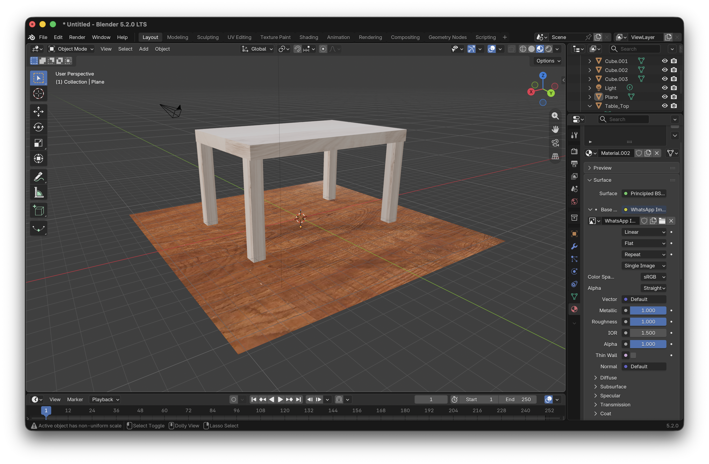

# 🧊 Blender 3D Modelling Labs (CS4731)

Lab and tutorial work for the **3D Modelling with Blender** course at RV University: modelling, materials and basic animation.

| Lab 1: Colour-mapped cube | Lab 2: Extrude, inset, bevel and loop cut | Lab 3: Hard-surface drawer unit |
|:---:|:---:|:---:|
|  |  |  |
| **Tutorial 1: Patterned cylinder** | **Tutorial 4: Table on a textured floor** | |
|  |  | |

## 📂 Files

| File | What it covers |
|---|---|
| `lab01.blend` | Basic primitives and per-face materials |
| `lab02.blend` | Designing a simple object with **extrude, inset, bevel and loop cut** |
| `LAB3.blend` | A **hard-surface model** (drawer unit) using more advanced modelling techniques |
| `tutorial01.blend` | Modelling and material practice |
| `table.blend` | Table model with a textured wooden floor |
| `CubeColourAnimation.blend` | Keyframed colour animation on a cube |
| `CarAnimation.blend` | Simple keyframed car animation |

## 🛠️ Tools

Blender 4.x · modelling, UV/materials and keyframe animation.

Open any `.blend` file in [Blender](https://www.blender.org/download/) to explore it.
